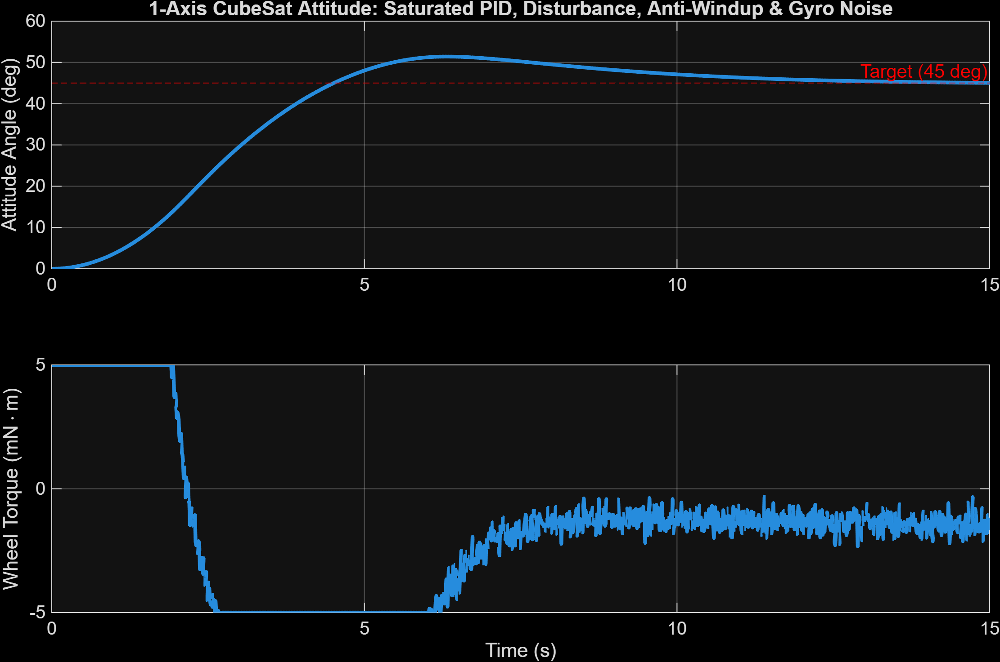

# 1-Axis CubeSat Reaction Wheel Attitude Controller

A first-principles GNC simulation in MATLAB and Simulink for a 3U CubeSat ($J = 0.05\text{ kg}\cdot\text{m}^2$) slewing from $0^\circ$ to $45^\circ$.

## Model & Control
- **Dynamics:** Single-axis rigid-body rotation $J\ddot{\theta} = \tau$, mapped to a second-order spring-mass-damper model to size $K_p$ and $K_d$ for $\zeta = 1.0$.
- **Simulation:** 100 Hz ($\Delta t = 0.01\text{ s}$) Forward Euler loop and equivalent Simulink block diagram.
- **Hardware Limits Tested:** Reaction wheel torque saturation ($\pm 5\text{ mN}\cdot\text{m}$), constant disturbance torque ($+1.5\text{ mN}\cdot\text{m}$), integral windup and anti-windup clamping, gyroscope noise ($0.2^\circ/\text{s}$).

## Results

The top plot shows the CubeSat attitude angle tracking the $45^\circ$ target with bounded windup overshoot, while the bottom plot shows reaction wheel torque saturation ($\pm 5\text{ mN}\cdot\text{m}$), gyroscope noise on the derivative term, and steady-state disturbance compensation.